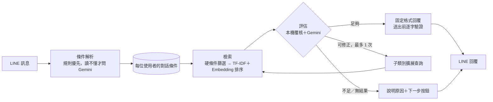

# 斗六美食推薦 CRAG × LINE 機器人

類神經網路商業應用期末專案。在 LINE 上用聊天的方式說「想吃什麼、預算多少、不要什麼」，系統從有證據的餐廳資料裡推薦斗六市最多 3 家店；資料不夠時會說明原因，不硬湊答案。

本文依課程的五個評分重點整理：[問題定義](#1-問題定義)、[方案設計](#2-方案設計)、[系統整合](#3-系統整合)、[結果驗證](#4-結果驗證)、[批判與反思](#5-批判與反思)（含[真實 AI 失誤案例](#真實-ai-失誤案例炒飯找不到)）。

## 1. 問題定義

**情境**：在斗六（雲科大、斗六車站一帶）想找東西吃時，常見的困擾是：
- Google Maps 看得到店，但看不到「這家有沒有賣我想吃的菜」「這道菜多少錢」，要一張張翻菜單照片。
- 直接問聊天機器人（一般大型語言模型），它可能編出不存在的店、錯的價格，而且講得很有自信。

**目標**：做一個 LINE 聊天機器人，
1. 聽得懂口語條件：「想吃麵」「一百五以內的牛肉麵」「不要火鍋」「雲科大附近」，並且多輪對話會記住條件。
2. 只推薦資料裡真的存在、條件有證據的店（最多 3 家），附地址、價格、地圖連結。
3. 證據不夠時寧可不推薦，並告訴使用者原因和下一步（例如「要不要取消預算限制？」），不自己放寬條件。

**範圍**：只有雲林縣斗六市；不做即時營業狀態、距離計算、過敏篩選（系統會說明做不到）。

## 2. 方案設計

採用 **CRAG（Corrective Retrieval-Augmented Generation，Yan et al., 2024）** 的概念：先檢索，再由評估器判斷檢索結果夠不夠好，不夠好就修正查詢重試或停止，而不是把檢索到的東西直接交給模型回答。這裡是簡化版，不是論文的完整重現。



| 設計決定 | 為什麼 |
|---|---|
| 條件解析「規則優先」，規則讀不懂才交給 Gemini；Gemini 的輸出要經程式檢查：菜名和預算數字必須出自使用者原句、料理只能用固定詞彙 | 常見句子不必花模型額度；模型可能「腦補」條件，所以只當草稿，由程式驗證 |
| 先用硬條件篩選（地區、料理、排除、預算），再排序；資料**未知**不等於**符合** | 排序分數再高，也不能讓不符條件的店被推薦 |
| 排序：TF-IDF 加上 Gemini Embedding，用 RRF 融合 | Embedding 只重新排序，不會把沒命中的店拉進來 |
| 評估：本機先核對候選的 ID、條件與分數，再交 Gemini 判斷 accept／retry／clarify／stop | 模型不能推翻本機已知的事實；格式錯誤或捏造 ID 一律停止 |
| 修正：只允許「子類別擴展」（例如麵食 → 牛肉麵、鍋燒意麵…），每輪最多 1 次 | 修正不能變成偷偷放寬預算或取消排除 |
| 回覆用固定模板，不讓模型自由撰寫；送出前驗證店名、地址逐字出自資料 | 最後一步不給模型編造的機會（模型撰寫回覆的方案 B 評估後不做） |
| 推薦依據到「每一道菜」：32 家店整理了 581 道主餐、其中 482 道有價格；每道菜有分類（關鍵字表＋21 道人工標註） | 「想吃炒飯」要找賣炒飯的店；「麵 100 元以內」要看麵的價格，不是整家店最便宜的菜 |

程式結構與元件對照見 [docs/ARCHITECTURE.md](docs/ARCHITECTURE.md)。

## 3. 系統整合

| 元件 | 用途 |
|---|---|
| LINE Messaging API | Webhook 簽章驗證（HMAC-SHA256）、重送事件去重、快速回覆按鈕 |
| Gemini API（gemini-3.5-flash-lite） | 讀不懂的句子轉成條件、評估檢索結果、引導對話 |
| Gemini Embedding（gemini-embedding-001） | 餐廳文字向量，事先建成快取，資料變動就自動停用 |
| Google Places API | 只在開發時收集一次斗六的店家（90 家），資料不放進 repo |
| Docker＋Cloudflare 臨時通道 | 在本機跑，產生 HTTPS 網址給 LINE 連入；`demo.ps1` 一鍵啟動並自動設定 Webhook |

**資料**：共 122 家。
- 32 家：依菜單照片人工整理（菜名、逐道價格、分類），在 [data/restaurants.json](data/restaurants.json)。
- 90 家：Google Places 收集，只有店名、類型、粗略價位，依 Google 使用條款不公開（見[資料與授權](#資料與授權)）。

程式只用 Python 標準函式庫（3.11 以上），沒有第三方套件。

### 執行方式（PowerShell）

先把 `.env.example` 複製成 `.env`，填入自己的金鑰（不要提交 `.env`）。

```powershell
$env:PYTHONPATH = 'src'
python -B -m unittest discover -s tests
```

```powershell
$env:PYTHONPATH = 'src'
python -B -m food_crag.server --env-file .env
```

本機啟動後，`http://127.0.0.1:8000/health` 是健康檢查，`POST /api/chat`（JSON：`user_id`、`message`）可以不透過 LINE 直接測試。

LINE 展示：開啟 Docker Desktop 後執行 `powershell -ExecutionPolicy Bypass -File .\demo.ps1`，結束時執行 `docker compose down`。機器人帳號不公開，在課堂上現場展示。

各端點、環境變數與 Embedding 快取的細節見 [docs/TECHNICAL_NOTES.md](docs/TECHNICAL_NOTES.md)。

## 4. 結果驗證

**自動測試**：134 項，全部通過。涵蓋條件解析、硬條件篩選、價格與預算、菜名分類、評估器的各種錯誤、回覆驗證、LINE 簽章與重送；外部 API 都以模擬取代，另有實際啟動本機 HTTP server 的整合測試。

**評估集**：[docs/DEMO_SCRIPT.md](docs/DEMO_SCRIPT.md) 共 10 句輸入，用 122 家資料、真實 Gemini 實測，每次重大修改後整套重跑並記錄。

| # | 輸入 | 結果 | 證明什麼 |
|---|---|---|---|
| 1 | 想吃麵 → 100元以內 | 推薦 3 家，第二句改列「100 元以內有：餛飩乾拌麵 85 元…」 | 多輪對話記得條件；預算看那類菜的價格 |
| 2 | 想吃豬排飯 | 只推薦有賣的 DL-004（咖哩豬排蛋包飯） | 依菜單品項推薦 |
| 3 | 一百五以內的牛肉麵 | 解析成牛肉麵＋150 元 | 自由輸入，條件由程式再驗證 |
| 4 | 想吃熱炒，不要台菜 | 不推薦，說明沒有自己放寬條件 | CRAG：證據不足就停 |
| 5 | 今天好累 → 還有其他的嗎？ | 引導選類型，跳出 13 個其他類型 | 會引導，不回答無關話題 |
| 6 | 想吃炸雞排 | 擴充資料前「沒有資料」，擴充後推薦 3 家 | 擴充資料有效 |
| 7 | 牛肉麵 50 元以內 | 不推薦（50 元的「牛肉湯麵」不含肉，已人工標註） | 預算改看菜價；字面比對的限制與補救 |
| 8 | 想吃炒飯 | 推薦淺草6號、武正水產 | 失誤案例修正後的驗證 |
| 9 | 牛排 300 以內 | 2 家都超過 300 元，不推薦 | 資料覆蓋的缺口 |
| 10 | 我花生過敏 | 說明無法過濾過敏原 | 知道自己做不到什麼 |

**實機驗證**：每個功能完成後都由使用者在 LINE 上實測驗收，紀錄在 [DEVELOPMENT_PLAN.md](DEVELOPMENT_PLAN.md)。

## 5. 批判與反思

### 真實 AI 失誤案例：炒飯找不到

| 階段 | 內容 |
|---|---|
| 發生 | 2026-11-21，第 12 項擴充 Google 資料時，為了替 Google 店分類，新增了「炒飯」等 13 個料理類型。這段修改由 AI（Claude Code）撰寫，當時的測試全部通過 |
| 發現 | 2026-11-23 擴充完成後整套重跑評估集，「想吃炒飯」回「資料裡還沒有店被分到炒飯」。但菜單資料裡明明有 2 家賣炒飯，擴充前也推薦得出來，這是**退化** |
| 原因 | 「炒飯」原本被當成菜名，用菜單逐道比對；變成料理類型後，比對只看整家店的分類標籤。武正水產（海鮮）、淺草6號（台菜、熱炒）的標籤裡沒有炒飯，所以被排除。舊測試只測「有賣某道菜」，沒有測「菜名同時也是料理類型」的情況 |
| 修正 | 每道菜也有分類：關鍵字表判斷，判斷不了或會判錯的 21 道人工標註；店家標籤不符，但有一道菜符合，也算符合。同樣的問題也修好了義大利麵、火鍋、炸物等類型 |
| 驗證 | 新增測試（炒飯必須找到 DL-013、DL-018）；真實 Gemini 重跑：推薦淺草6號（有賣：豬肉炒飯和蝦仁炒飯）、武正水產；使用者在 LINE 實測通過 |

次要案例：「想吃豬排飯」曾推薦肉燥飯、豬腳飯的店，開頭卻寫「想吃豬排飯的話」。原因是菜名只拿來排序，沒有檢查店家有沒有賣；改為依 581 道菜單品項比對後修正（見評估集 #2）。

### 目前的限制

- **同一句話，AI 評估的結果可能不同**：Gemini 的判斷不保證每次一樣，系統只能保證它不能推薦不符條件的店。
- **90 家 Google 店沒有菜單**：只能依店名和類型分類，價格只有粗略區間，有預算時常常無法確認。
- **人工標註要靠人維護**：例如「牛肉湯麵」菜單註明不含肉，字面比對看不出來，只能人工標註；菜單改了要記得一起改。
- **資料覆蓋不平均**：火鍋有 20 家，牛排只有 2 家。
- **CRAG 的修正分支很少觸發**：加入菜單品項後，第一次檢索通常就夠準，修正只對「麵食」「飯食」這類上層分類有效。
- **不是即時資料**：營業時間、價格都沒有向店家確認；對話條件存在記憶體，重啟就清空。
- **免費額度**：Gemini 免費方案有每分鐘次數上限，連續大量測試可能暫時失敗。

### 反思

- **測試通過不等於沒有退化**：炒飯案例的單元測試全部通過，是整套重跑評估集才抓到。所以每次大修改後都整套重跑，並把結果寫進評估集紀錄。
- **讓模型做判斷，讓程式守事實**：模型負責理解口語和評估，事實（有沒有這家店、有沒有賣、多少錢）一律由程式對照資料驗證。
- **「不推薦」也是一種正確答案**：資料不夠時說清楚原因，並給下一步按鈕，比硬湊 3 家更可信。

## AI 使用聲明

本專案在開發過程中使用 AI（Claude Code）協助撰寫程式、測試與文件，commit 紀錄中的 `Co-Authored-By: Claude` 即為標示。需求、設計取捨（例如預算怎麼算、哪些菜算哪一類、資料不足時要不要推薦）都由作者決定；每次修改都經過自動測試、真實 API 實測，並由作者在 LINE 上驗收。系統執行時使用 Google Gemini 模型。

## 資料與授權

- [data/restaurants.json](data/restaurants.json) 的 32 家店依網路上的菜單照片整理，僅供課堂作業使用；價格與營業狀態未向店家確認。
- Google Places 的資料依 Google 使用條款不得轉發，因此不放進 repo（`.gitignore` 已排除）。需要的話可以用自己的金鑰執行 `food_crag.collect_places` 收集，步驟見 `.env.example`。

## 文件索引

- [docs/ARCHITECTURE.md](docs/ARCHITECTURE.md)：系統架構與程式對照
- [docs/DEMO_SCRIPT.md](docs/DEMO_SCRIPT.md)：評估集與每次重跑紀錄
- [DEVELOPMENT_PLAN.md](DEVELOPMENT_PLAN.md)：開發步驟、決策與驗收紀錄
- [data/README.md](data/README.md)、[data/DATA_FIELDS.md](data/DATA_FIELDS.md)：資料與欄位說明
- [docs/TECHNICAL_NOTES.md](docs/TECHNICAL_NOTES.md)：各階段的技術細節（開發過程中的舊版 README）
- [docs/REUSE_REVIEW.md](docs/REUSE_REVIEW.md)：從 Mini CRAG 教學程式沿用的部分
