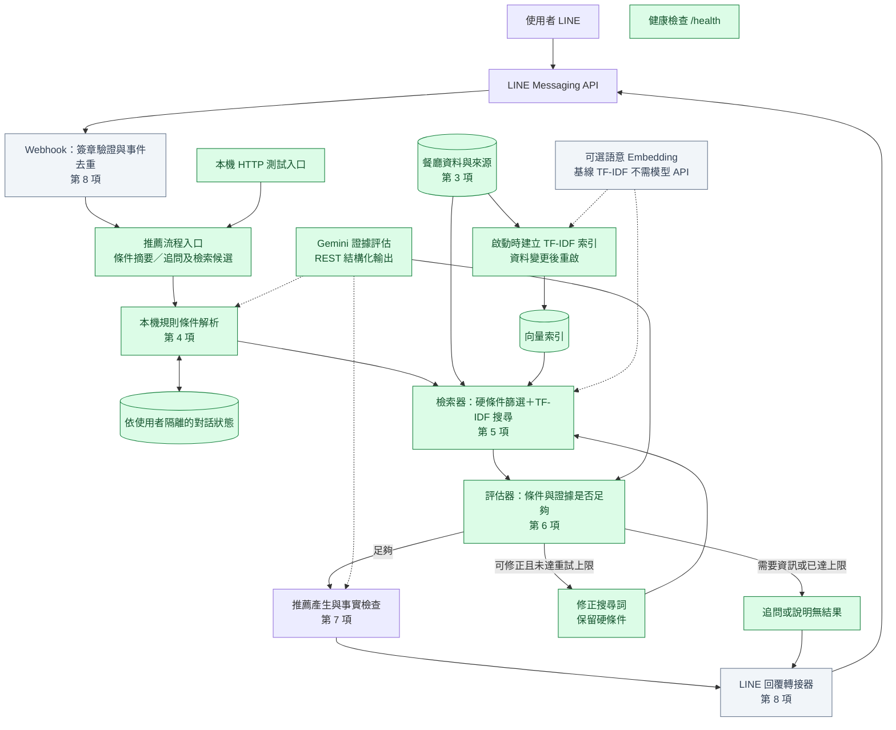

# 斗六餐飲推薦 LINE 聊天機器人：系統架構

這是目標架構。綠色代表目前已具備的元件，灰色代表已定義介面但尚未實作，其他節點為後續工作。

## 程式對照

| 元件 | 位置 | 現況 |
|---|---|---|
| HTTP 與健康檢查 | src/food_crag/server.py | /api/chat 本機測試入口；/webhooks/line LINE 入口 |
| 環境設定 | src/food_crag/config.py | 可讀取環境變數；憑證不列入 repr |
| 資料契約 | src/food_crag/domain.py | 條件、餐廳、候選與評估結果 |
| 元件介面 | src/food_crag/ports.py | Protocol；解析器回傳條件與澄清結果 |
| 條件解析 | src/food_crag/criteria.py | re＋同義詞表；未知／衝突整輪保留原狀 |
| 對話狀態 | src/food_crag/conversation.py | user_id 隔離的記憶體狀態；程序重啟清空 |
| 流程入口 | src/food_crag/pipeline.py | 條件狀態→檢索→本機覆核／Gemini 評估→最多一次等義詞修正 |
| 檢索與詞彙計分 | src/food_crag/retriever.py、tfidf.py | 硬條件篩選、預建索引、排序與篩除原因；回傳未評估候選 |
| Gemini／LINE | src/food_crag/adapters/ | Gemini REST 評估；LINE 簽章驗證、事件去重、背景處理與 reply API（line.py） |
| 餐廳資料 | data/restaurants.json | 31 筆來源紀錄（含菜單照片主餐標價）；以 dataset.py 驗證及載入 |

## 原系統沿用對照（已檢視）

| 原系統概念 | 餐飲版本接入點 | 需檢視內容 |
|---|---|---|
| 文件檢索器 | Retriever.search | 向量模型、索引與 metadata 篩選 |
| 文件評估器 | Evaluator.evaluate | prompt、輸出格式、相關性判準 |
| 查詢改寫與重試 | pipeline | 路由與重試上限；不得自行放寬硬條件 |
| 回答模型 | LanguageModel / ReplyGenerator | 模型客戶端、來源依據与輸出驗證 |

已確認 mini_crag_tutorial 的 TF-IDF 與診斷函式可移植；第 5 項已移植 TF-IDF 檢索核心；第 6 項已加入本機否決＋Gemini 評估及最多一次等義詞修正；最終推薦仍未實作。詳見 [原碼沿用檢視](REUSE_REVIEW.md)。基線採本機 TF-IDF 稀疏向量，並非神經網路語意 embedding；圖中的 embedding 模型為可選擴充。

## 邊界與後續部署

- 本機標準函式庫 HTTP server 用於骨架驗證；公開部署前以正式 Web 框架與 HTTPS 承載，屬第 8～9 項。
- Gemini 生成與 embedding 分開設定；搜尋分數計算與資料篩選在程式內完成。
- 對話狀態、每輪評估紀錄、一次修正、LINE 簽章驗證與事件去重已實作；狀態存在記憶體，重啟清空。
- 第 4 項採本機規則方案；Gemini 已接入第 6 項證據評估，但不是目前條件解析的依賴。
- 資料來源與日期應隨推薦保留；不把未知價格或營業狀態當成符合條件。
