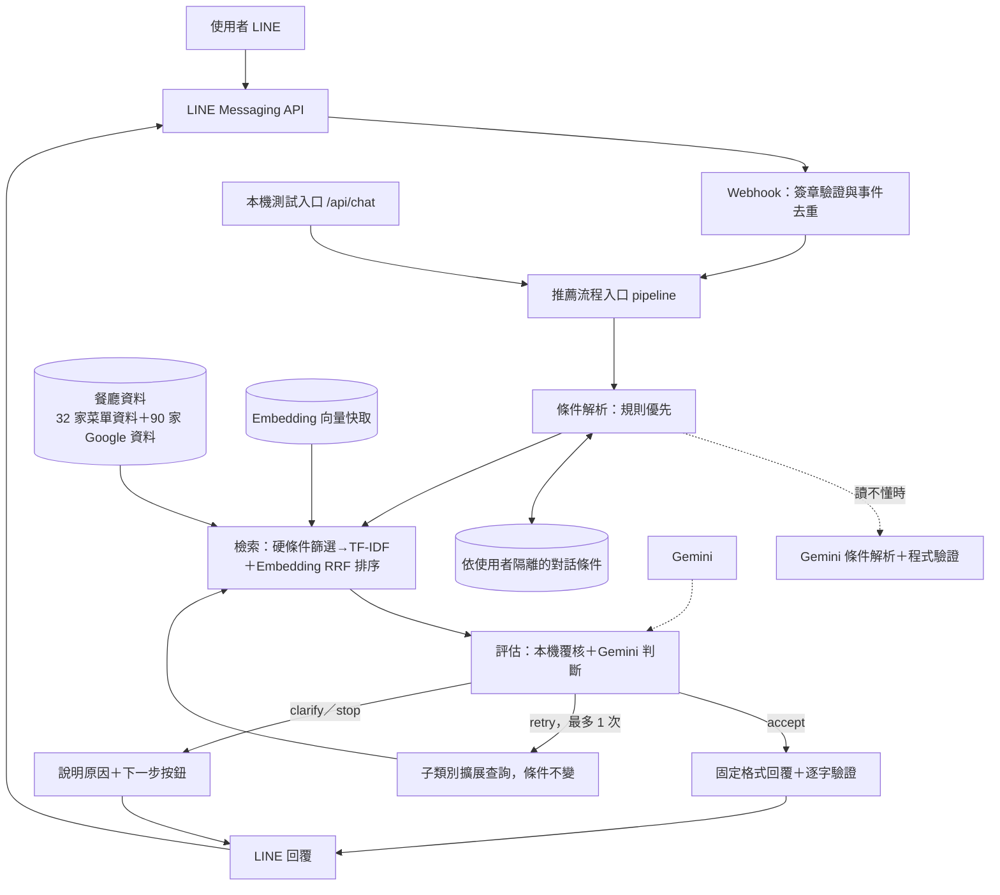

# 斗六美食推薦機器人：系統架構

所有元件都已實作並經 LINE 實測驗收（2026-11-23）。虛線表示呼叫外部模型。

## 程式對照

| 元件 | 位置 | 說明 |
|---|---|---|
| HTTP 與健康檢查 | src/food_crag/server.py | /health、/api/chat（本機測試，公開時關閉）、/webhooks/line |
| 環境設定 | src/food_crag/config.py | 只讀環境變數或明確指定的 .env；憑證不列入 repr |
| 資料契約 | src/food_crag/domain.py | 條件、餐廳、候選、評估結果 |
| 資料載入 | src/food_crag/dataset.py | 驗證欄位與來源後載入；有設定時合併 Google 資料 |
| 條件解析 | src/food_crag/criteria.py | 規則＋同義詞表；衝突或未知時整輪不改條件 |
| 自由輸入 | src/food_crag/llm_criteria.py | 規則讀不懂時交給 Gemini；菜名與預算必須出自原句 |
| 對話狀態 | src/food_crag/conversation.py | 以使用者隔離的記憶體狀態；重啟清空 |
| 檢索 | src/food_crag/retriever.py、tfidf.py | 硬條件篩選、菜名與逐道價格比對、每道菜的分類、TF-IDF 排序 |
| 語意排序 | src/food_crag/embedding.py | Gemini Embedding 快取與 RRF 融合；只重新排序 |
| 評估與修正 | src/food_crag/evaluator.py | 本機覆核＋Gemini 評估；每輪最多 1 次子類別擴展 |
| 推薦回覆 | src/food_crag/recommendation.py | 固定格式、預算內品項、無推薦時的說明與按鈕；送出前驗證 |
| 流程入口 | src/food_crag/pipeline.py | 解析→檢索→評估→回覆；引導按鈕與「還有其他的嗎？」 |
| 外部服務 | src/food_crag/adapters/ | gemini.py（REST）、line.py（簽章、去重、reply API） |
| Google 資料收集 | src/food_crag/collect_places.py | 開發時收集一次；輸出不進 git |
| 部署 | Dockerfile、docker-compose.yml、demo.ps1 | 本機容器＋Cloudflare 臨時通道；一鍵設定 LINE Webhook |

## 原系統沿用

TF-IDF 計分、中文 bigram 斷詞與診斷函式移植自 mini_crag_tutorial；餐飲條件、評估規則與回覆都是重寫的。詳見 [原碼沿用檢視](REUSE_REVIEW.md)。

## 邊界

- 執行環境是本機 Docker＋臨時通道，只在展示時在線；不是 24 小時服務。
- 對話條件與事件去重紀錄存在記憶體，重啟清空。
- 價格、營業時間、菜單都沒有向店家確認；未知不當成符合。
